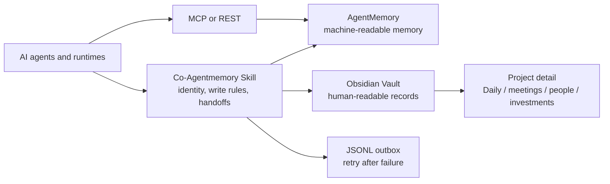

# Co-Agentmemory

An open, vendor-neutral shared memory system for AI agents.

[简体中文](./README.zh-CN.md)

Co-Agentmemory is an extension of [AgentMemory](https://github.com/rohitg00/agentmemory). It keeps AgentMemory as the machine-readable memory engine and adds an Obsidian-based human-readable workspace around it. The result is one shared memory workflow that can be used from Codex, Claude, Hermes, OpenClaw, GitHub Copilot, IDE agents, and other MCP-compatible runtimes.

Co-Agentmemory is an integration protocol and Skill, not a replacement for AgentMemory and not an official AgentMemory distribution. AgentMemory provides the service, REST API, MCP server, search, and memory primitives. Co-Agentmemory defines how agents identify themselves, decide what to write, use Obsidian, hand work to one another, and recover from a failed write.

## Why This Exists

Using several AI agents creates a continuity problem:

- Each agent tends to remember only its own conversations.
- The same project context is repeated in different tools and gradually diverges.
- Machine memory is useful for retrieval but difficult for a human to inspect and edit.
- Markdown notes are readable and auditable but inefficient to search blindly on every session.
- Meeting notes, daily events, project state, investment records, and agent operations become mixed together.
- A failed network call can leave one memory layer updated and the other layer stale.
- Adding an MCP server exposes tools, but does not by itself define when an agent should read, write, summarize, or hand off memory.

Co-Agentmemory addresses these problems with a shared machine layer, a human layer, explicit write rules, stable identities, targeted retrieval, and a retryable outbox.

## Architecture



The system has two physical layers and three write tiers:

| Tier | What it contains | AgentMemory | Obsidian |
|---|---|---:|---:|
| Memory | Durable state, decisions, pointers, handoffs | Yes | Concise current-state record |
| Project | Plans, debugging history, design rationale, long reports | Pointer or summary | Full project document |
| Routine | What happened during a work session | One observation | Dated operational log |

AgentMemory acts as the compact retrieval index. Obsidian keeps the source material, relationships, human edits, and audit trail. The Skill does not require every paragraph to be copied into both systems; it requires durable state and routine progress to be represented in both layers, while detailed project work remains in the project directory.

## Main Features

- **Shared memory across agents:** every runtime can use the same AgentMemory endpoint and project IDs.
- **Human-readable audit layer:** Obsidian holds Daily notes, meetings, people, projects, investments, decisions, and handoffs as ordinary Markdown.
- **Tiered writing:** memory, project detail, and routine progress have different destinations, which keeps retrieval concise.
- **First-hand records:** the agent that observes an event can write it directly; a curator is optional.
- **Stable identity:** `actor_id`, `runtime_id`, `environment_id`, `project_id`, and `session_id` remain separate.
- **Targeted retrieval:** agents query relevant slots and project context before opening a small set of Obsidian files.
- **Failure recovery:** helper scripts preserve failed AgentMemory writes in a local JSONL outbox.
- **Provider flexibility:** AgentMemory can run keyless with BM25, use local embeddings, or use a configured remote embedding provider. LLM summarization is optional.
- **Client neutrality:** the shared protocol is separate from each client's MCP, Skill, hook, or plugin configuration.
- **No personal defaults:** this public repository contains no private endpoint, home path, API key, or user-specific project.

## Install This Skill

Place this repository in the Skill directory supported by your agent and reload the client. The exact installation path is client-specific. Read [`SKILL.md`](./SKILL.md) for the full operating rules and [`SKILL.zh-CN.md`](./SKILL.zh-CN.md) for the Chinese version.

The Skill installation and AgentMemory deployment are separate steps. You need both before an agent can perform a complete dual-layer write.

## Deploy AgentMemory

Co-Agentmemory uses the upstream AgentMemory service. Follow the upstream project for the current release, package version, and provider options.

### Option A: local process

Requirements: Node.js 20 or newer, npm/npx, and a local persistent data directory.

```bash
npx -y @agentmemory/agentmemory@latest
```

The setup command initializes AgentMemory, starts the service, and offers client integration. The default local endpoints are:

```text
REST API:  http://127.0.0.1:3111
Viewer:    http://127.0.0.1:3113
```

The upstream configuration is normally stored in `~/.agentmemory/.env`. If you did not set an explicit secret, the upstream local installation normally generates one at `~/.agentmemory/secret`. In the same trusted local shell that will run the helpers, load it without printing it:

```bash
read -r AGENTMEMORY_SECRET < "$HOME/.agentmemory/secret"
export AGENTMEMORY_SECRET
```

If you set an explicit service secret or customized the data directory, inject that actual value instead. Confirm the current paths in the upstream documentation.

### Option B: Docker Compose

Use the Compose files and Dockerfile from the upstream AgentMemory repository. The upstream deployment keeps the engine, HTTP worker, Viewer, secret, indexes, and state under a persistent `/data` volume.

```bash
git clone https://github.com/rohitg00/agentmemory.git
cd agentmemory
cp .env.example .env

# Edit .env for ports, auth, embeddings, origins, and storage.
docker compose up --build -d
```

Verify the service before connecting agents:

```bash
curl -fsS http://127.0.0.1:3111/agentmemory/livez
curl -fsS http://127.0.0.1:3111/agentmemory/health
```

Open `http://127.0.0.1:3113` in your browser for the Viewer.

The upstream Compose deployment uses ports `3111` for REST and `3113` for the Viewer. Bind them to loopback for a local-only deployment. For a NAS, LAN, or cloud deployment, put the service behind a firewall or TLS reverse proxy, configure the allowed hosts and origins, and keep the internal engine port private. Back up the complete persistent `/data` volume before upgrades. Do not use `docker compose down -v` unless deleting all memory data is intended.

See [upstream Docker deployment instructions](https://github.com/rohitg00/agentmemory/blob/main/deploy/README.md) for platform-specific startup, storage and authentication details. Docker build arguments and worker versions belong to the upstream revision you checked out.

For a local Compose deployment using the generated secret, the trusted shell running the helpers can load it without displaying it:

```bash
export AGENTMEMORY_SECRET="$(docker compose exec -T agentmemory cat /data/secret)"
```

Run that command from the upstream Compose directory. If the service has an explicitly configured secret, inject that value instead. Do not display, commit, or send the secret to an agent through chat.

**Compatibility:** the bundled write helpers were tested against the AgentMemory `0.9.31` response shape, not every later release. The commands above install the latest upstream version; check compatibility with a disposable test deployment before using it with existing data. Co-Agentmemory does not ship or pin an AgentMemory server.

## Configure AgentMemory

AgentMemory can run without an LLM provider. In that mode, keyword retrieval through BM25 remains available, while LLM-written compression, reflection, and consolidation are disabled.

For local semantic embeddings, configure the upstream environment file with:

```dotenv
EMBEDDING_PROVIDER=local
```

The first embedding request downloads the local model, so the deployment needs network access during the initial download. For remote embeddings, use the provider-specific variables documented by AgentMemory. A typical OpenAI-compatible setup has this shape:

```dotenv
EMBEDDING_PROVIDER=openai
OPENAI_EMBEDDING_API_KEY=your-key
OPENAI_EMBEDDING_BASE_URL=https://your-compatible-endpoint/v1
OPENAI_EMBEDDING_MODEL=your-embedding-model
OPENAI_EMBEDDING_DIMENSIONS=1536
```

Use the dimension required by the selected embedding model. If the dimension or model changes, follow the upstream migration and index rebuild procedure; do not mix vectors generated with incompatible dimensions.

LLM features are optional. A provider key alone does not mean that Co-Agentmemory should summarize everything. Enable AgentMemory's automatic compression or consolidation only when you have decided that the cost, privacy, and output behavior are acceptable. Co-Agentmemory's core workflow works with concise agent-authored records and does not require an LLM summarizer.

Set an explicit bearer secret for a remote deployment:

```dotenv
AGENTMEMORY_SECRET=generate-a-long-random-secret
```

Keep this value in the service secret store or runtime environment. Never commit it to this repository, an Obsidian note, a profile, or a handoff.

## Connect an Agent with MCP

The AgentMemory MCP shim is normally registered in the target client's own configuration. A common stdio entry is:

```json
{
  "command": "npx",
  "args": ["-y", "@agentmemory/mcp"],
  "env": {
    "AGENTMEMORY_URL": "${AGENTMEMORY_URL}",
    "AGENTMEMORY_SECRET": "${AGENTMEMORY_SECRET}"
  }
}
```

Merge the `agentmemory` entry into the client's existing MCP server collection. The placeholder syntax is client-dependent; use the client's secret store or environment injection. Do not assume that `agents/openai.yaml` configures MCP for every client. It is only OpenAI/Codex-style UI metadata.

Client-specific examples and validation rules are in [`references/mcp-onboarding.md`](./references/mcp-onboarding.md). An MCP tool listing proves that tools are exposed; it does not prove that automatic capture hooks, authentication, search, or durable writes are working.

## Configure a Local Co-Agentmemory Profile

Create the agent workspace index in the target Vault:

```text
<vault>/Agent_Comemory/00_Index/README.md
```

Then run the onboarding helper:

```bash
python3 scripts/onboard.py \
  --runtime codex \
  --environment laptop \
  --vault /absolute/path/to/vault \
  --agentmemory-url http://127.0.0.1:3111 \
  --timezone UTC
```

Use `--bot <stable-id>` for a platform hosting multiple Bots. The helper creates a local profile with the Vault path, workspace directories, timezone, service URL, and identity. It never stores `AGENTMEMORY_SECRET`.

Onboarding prints the path of the per-actor profile. Select that profile in every shell or agent process that runs the helpers, for example:

```bash
export CO_MEMORY_PROFILE="$HOME/.config/co-agentmemory/profiles/codex.json"
```

For a Bot, use the exact path printed by onboarding. Alternatively, set the environment variables below; environment values take precedence over the profile.

The public defaults are:

```text
Agent workspace: Agent_Comemory/
Personal wiki:   Personal_Wiki/
Agent logs:      Agent_Comemory/03_Logs/YYYY/YYYY-MM/YYYY-MM-DD.md
Personal Daily:  Personal_Wiki/01_Daily/YYYY/YYYY-MM-DD.md
```

Change these names with `CO_MEMORY_AGENT_COMEMORY_DIR` and `CO_MEMORY_PERSONAL_WIKI_DIR`, or the matching profile fields. Set the secret in the process that starts the helper or MCP server:

```bash
export AGENTMEMORY_URL=http://127.0.0.1:3111
export CO_MEMORY_VAULT_ROOT=/absolute/path/to/vault
export CO_MEMORY_ACTOR_ID=codex
export CO_MEMORY_TIMEZONE=UTC
```

Inject `AGENTMEMORY_SECRET` through your secret manager or runtime; avoid putting a literal secret in shell history.

Run a health check:

```bash
python3 scripts/doctor.py
python3 scripts/doctor.py --check-mcp
```

The health check is advisory. Liveness is not proof of an authenticated search or a successful write; validate the exact client route when onboarding a new runtime.

## Use the Shared Workflow

At the start of a session, read the shared index and writing protocol, retrieve relevant AgentMemory slots, and open only the Obsidian files named by the result or project index. Use the same stable `project_id` when continuing work from another agent.

Write a routine log to both layers:

```bash
python3 scripts/write_log.py \
  --actor "$CO_MEMORY_ACTOR_ID" \
  --project "research-notes" \
  --action "finished the source review" \
  --status success \
  --files "notes/review.md" \
  --note "The next agent can continue from the project note."
```

Create a handoff when another session needs an explicit continuation:

```bash
python3 scripts/write_handoff.py \
  --from "$CO_MEMORY_ACTOR_ID" \
  --to "next-agent" \
  --project "research-notes" \
  --summary "Source review is complete" \
  --next "Compare the two remaining options"
```

When AgentMemory is unavailable, the scripts write a JSONL outbox and return non-zero by default. Restore connectivity and retry:

```bash
python3 scripts/doctor.py --flush-outbox
```

Retries are at-least-once. An ambiguous timeout may mean the service already accepted the record, so inspect search results before deciding whether a duplicate needs cleanup.

## Obsidian Collaboration Rules

```text
Vault/
├── Personal_Wiki/
│   ├── 01_Daily/YYYY/YYYY-MM-DD.md
│   ├── 02_Inbox/
│   ├── 03_People/
│   ├── 04_Meetings/
│   ├── 05_Projects/
│   ├── 06_Investments/
│   ├── 07_Links/
│   ├── 08_Knowledge/
│   └── 09_Archive/
└── Agent_Comemory/
    ├── 00_Index/
    ├── 01_Shared/
    ├── 02_Agents/<actor-id>.md
    ├── 02_Projects/<project-id>/
    ├── 03_Logs/YYYY/YYYY-MM/YYYY-MM-DD.md
    ├── 04_Decisions/
    ├── 05_Handoffs/YYYY/YYYY-MM/
    └── 09_Archive/<project-id>/
```

Daily notes use one file per date under a year folder. A dated real-world event gets one concise timeline entry linked to its meeting, person, project, or investment note. Uncertain dates go to Inbox. Agent operations stay in `Agent_Comemory/03_Logs/`.

When a project is explicitly completed, stopped, or archived, move its active project folder to the corresponding `09_Archive/` path, mark its current memory state archived or stopped, and update active indexes. Preserve historical Daily entries, meetings, logs, handoffs, and mentions.

## Boundaries

- AgentMemory does not automatically index every Obsidian file. Agents must write pointers or use a separate indexing workflow.
- An MCP connection does not automatically make every agent capture every turn. Hooks and lifecycle integrations are client-specific.
- AgentMemory search is not an access-control boundary; protect the service and choose scopes deliberately.
- Keep secrets out of both layers. Memory text may still be sensitive; protect the Vault, AgentMemory data volume, backups, and outbox.
- Use the upstream AgentMemory README for complete tool inventories, release-specific settings, migrations, and provider documentation.

## Repository Guide

- [`SKILL.md`](./SKILL.md): English operating protocol.
- [`SKILL.zh-CN.md`](./SKILL.zh-CN.md): Chinese operating protocol.
- [`UNIVERSAL_AGENT_GUIDE.md`](./UNIVERSAL_AGENT_GUIDE.md): prompt-style guide for clients without native Skills.
- [`references/configuration.md`](./references/configuration.md): profiles and environment variables.
- [`references/mcp-onboarding.md`](./references/mcp-onboarding.md): MCP connection patterns.
- [`references/obsidian-collaboration.md`](./references/obsidian-collaboration.md): Vault rules.
- [`references/agentmemory-integration.md`](./references/agentmemory-integration.md): AgentMemory compatibility boundary.
- [`scripts/`](./scripts): optional standard-library helpers.

## Development

The helpers require Python 3.10 or newer and use only the standard library. Windows installations without IANA timezone data also need the `tzdata` package:

```bash
python3 -m unittest discover -s tests -v
python3 -m py_compile scripts/*.py
```

## License

MIT. See [`LICENSE`](./LICENSE).
