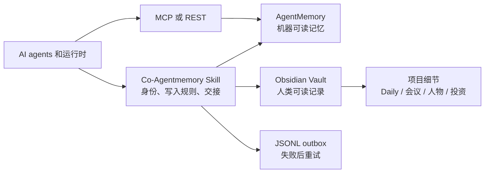

# Co-Agentmemory

一个面向多 Agent 协作的、与厂商无关的共享记忆库系统。

[English](./README.md)

Co-Agentmemory 是在 [AgentMemory](https://github.com/rohitg00/agentmemory) 基础上延伸出来的协作协议和 Skill。它保留 AgentMemory 作为机器可读的记忆引擎，同时引入 Obsidian 作为人类可读的工作区，让 Codex、Claude、Hermes、OpenClaw、GitHub Copilot、各种 AI IDE 和其他 MCP 客户端可以共享同一套长期工作上下文。

Co-Agentmemory 是 AgentMemory 的集成层和使用规范，不是 AgentMemory 的替代品，也不代表 AgentMemory 官方。AgentMemory 提供服务、REST API、MCP Server、检索和记忆原语；Co-Agentmemory 规定 agent 如何识别自己、什么时候读写记忆、如何使用 Obsidian、如何交接工作，以及写入失败后如何恢复。

## 它解决什么问题

同时使用多个 AI 工具时，通常会遇到这些问题：

- 每个 agent 只记得自己的对话，换工具就丢失上下文。
- 同一个项目的背景被重复写入多个工具，随后逐渐产生分歧。
- 机器记忆便于检索，却不容易让人检查、编辑和审计。
- Markdown 文档方便阅读，但每次全量扫描会浪费时间和 token。
- 会议、Daily、人物、项目、投资记录和 agent 操作日志互相混杂。
- 网络故障可能造成一层已经写入，另一层没有同步。
- 配好 MCP 只代表工具可用，并没有规定 agent 什么时候读取、写入、总结和交接。

Co-Agentmemory 用共享的机器记忆层、人类可读层、明确的写入规则、稳定身份、定向检索和可重试 outbox 处理这些问题。

## 架构



系统由两层和三档写入组成：

| 层级 | 内容 | AgentMemory | Obsidian |
|---|---|---:|---:|
| Memory | 长期状态、决策、指针、handoff | 写入 | 简短当前状态 |
| Project | 计划、排查过程、设计依据、长报告 | 指针或摘要 | 完整项目文档 |
| Routine | 工作过程中发生了什么 | 一条 observation | 日期操作日志 |

AgentMemory 负责紧凑的检索索引；Obsidian 保存源材料、人类编辑、文档关系和审计历史。Co-Agentmemory 不要求把每一段文字复制两遍，而是要求长期状态和例行进展在两层都有记录，详细项目内容保留在项目目录中。

## 主要特点

- **跨 Agent 共享记忆**：不同运行时连接同一个 AgentMemory 地址，使用统一的项目标识。
- **人类可读的审计层**：Obsidian 保存 Daily、会议、人物、项目、投资、决策和 handoff 等普通 Markdown。
- **分级写入**：长期记忆、项目细节和例行进度使用不同位置，避免记忆库膨胀。
- **一手记录**：产生信息的 agent 可以直接写入，不要求所有信息经过一个 curator。
- **稳定身份**：`actor_id`、`runtime_id`、`environment_id`、`project_id`、`session_id` 分开管理。
- **定向检索**：先检索相关 slots 和项目上下文，再打开少量 Obsidian 文档。
- **失败恢复**：AgentMemory 写入失败时，脚本将 payload 保存在 JSONL outbox 中。
- **模型可选**：AgentMemory 可以无模型运行 BM25，也可以使用本地 embedding 或远程 embedding；LLM 总结是可选功能。
- **客户端无关**：共享协议与每个客户端自己的 MCP、Skill、hook 和 plugin 配置分开。
- **没有个人默认值**：公开仓库不包含私有地址、个人路径、API key 或个人项目。

## 安装 Skill

将本仓库放进目标 agent 支持的 Skill 目录，然后重启或重新加载客户端。具体安装位置取决于客户端。完整规则见 [`SKILL.zh-CN.md`](./SKILL.zh-CN.md)，英文版见 [`SKILL.md`](./SKILL.md)。

Skill 安装和 AgentMemory 部署是两个步骤。只有两者都完成，agent 才能执行完整的双层写入。

## 部署 AgentMemory

Co-Agentmemory 使用上游 AgentMemory 服务。版本、完整工具列表、provider 和迁移方法以 [AgentMemory 上游文档](https://github.com/rohitg00/agentmemory) 为准。

### 方式一：本地进程

需要 Node.js 20 或更高版本、npm/npx，以及持久化的数据目录。

```bash
npx -y @agentmemory/agentmemory@latest
```

该命令会初始化 AgentMemory、启动服务，并提供客户端接入选项。默认本地地址是：

```text
REST API： http://127.0.0.1:3111
Viewer：   http://127.0.0.1:3113
```

上游配置通常位于 `~/.agentmemory/.env`。没有显式设置 secret 时，上游本地安装通常会在 `~/.agentmemory/secret` 生成它。可在运行脚本的可信本机 shell 中读取，避免直接打印：

```bash
read -r AGENTMEMORY_SECRET < "$HOME/.agentmemory/secret"
export AGENTMEMORY_SECRET
```

如果服务使用显式 secret 或自定义数据目录，请改为注入对应的真实值，并以上游文档为准确认路径。

### 方式二：Docker Compose

使用上游 AgentMemory 仓库中的 Compose 文件和 Dockerfile。上游部署会把 engine、HTTP worker、Viewer、secret、索引和状态保存到持久化的 `/data` volume。

```bash
git clone https://github.com/rohitg00/agentmemory.git
cd agentmemory
cp .env.example .env

# 根据需要编辑 .env：端口、认证、embedding、跨域和存储。
docker compose up --build -d
```

启动后检查：

```bash
curl -fsS http://127.0.0.1:3111/agentmemory/livez
curl -fsS http://127.0.0.1:3111/agentmemory/health
```

在浏览器中打开 `http://127.0.0.1:3113` 查看 Viewer。

上游 Compose 默认使用 `3111` REST 端口和 `3113` Viewer 端口。仅本机使用时绑定 loopback；部署到 NAS、局域网或云端时，应通过防火墙或 TLS 反向代理保护服务，配置允许的 Host 和 Origin，并保持内部 engine 端口私有。升级前备份完整的 `/data` volume。除非明确要删除全部记忆，否则不要执行 `docker compose down -v`。

不同平台的启动、存储和认证细节见 [AgentMemory 上游 Docker 部署文档](https://github.com/rohitg00/agentmemory/blob/main/deploy/README.md)。Docker 构建参数和 worker 版本以上游检出的版本为准。

本地 Compose 使用自动生成的 secret 时，可在运行脚本的可信 shell 中读取，避免直接显示：

```bash
export AGENTMEMORY_SECRET="$(docker compose exec -T agentmemory cat /data/secret)"
```

该命令需要在上游 Compose 目录执行。如果服务显式配置了 secret，则注入该值。不要把 secret 打印、提交，或通过聊天发送给 agent。

**兼容性：** 本仓库的写入脚本针对 AgentMemory `0.9.31` 的响应格式验证过，并未验证所有后续版本。上面的命令安装上游最新版；用于已有数据前，请先在独立测试环境验证兼容性。Co-Agentmemory 不附带或锁定 AgentMemory 服务端版本。

## 配置 AgentMemory

AgentMemory 不配置 LLM 也可以运行。此时 BM25 关键词检索仍然可用，LLM 压缩、反思和 consolidation 会关闭。

如果需要本地语义 embedding，可以在上游环境文件中设置：

```dotenv
EMBEDDING_PROVIDER=local
```

第一次发起 embedding 请求时会下载本地模型，所以首次初始化需要网络。使用远程 embedding 时，根据 AgentMemory 文档设置对应 provider 的变量。OpenAI 兼容服务通常类似：

```dotenv
EMBEDDING_PROVIDER=openai
OPENAI_EMBEDDING_API_KEY=your-key
OPENAI_EMBEDDING_BASE_URL=https://your-compatible-endpoint/v1
OPENAI_EMBEDDING_MODEL=your-embedding-model
OPENAI_EMBEDDING_DIMENSIONS=1536
```

维度必须与 embedding 模型一致。如果更换模型或维度，应按照上游迁移和索引重建流程处理，不能混用不同维度的向量。

LLM 功能是可选的。配置 provider key 不等于 Co-Agentmemory 必须自动总结所有内容。只有在确认费用、隐私和输出行为后，才启用 AgentMemory 的自动压缩或 consolidation。Co-Agentmemory 的核心流程依赖简短、事实化的 agent 记录，不要求 LLM 总结器。

远程部署时设置 bearer secret：

```dotenv
AGENTMEMORY_SECRET=generate-a-long-random-secret
```

将它放在服务的 secret store 或运行时环境中，不能提交到仓库、写入 Obsidian、profile 或 handoff。

## 通过 MCP 接入 Agent

AgentMemory MCP shim 通常写入目标客户端自己的配置。常见的 stdio 结构是：

```json
{
  "command": "npx",
  "args": ["-y", "@agentmemory/mcp"],
  "env": {
    "AGENTMEMORY_URL": "${AGENTMEMORY_URL}",
    "AGENTMEMORY_SECRET": "${AGENTMEMORY_SECRET}"
  }
}
```

把 `agentmemory` 条目合并到客户端已有的 MCP Server 集合中。变量占位符的写法由客户端决定，应使用客户端的 secret store 或环境注入。`agents/openai.yaml` 只有 OpenAI/Codex 风格客户端的界面元数据，不能替代其他客户端的 MCP 配置。

客户端示例和验证规则见 [`references/mcp-onboarding.md`](./references/mcp-onboarding.md)。能列出 MCP 工具只证明工具暴露成功，不能证明自动捕获 hook、认证、检索或持久写入已经正常。

## 配置 Co-Agentmemory Profile

先在目标 Vault 中创建 agent 工作区索引：

```text
<vault>/Agent_Comemory/00_Index/README.md
```

然后运行首次接入向导：

```bash
python3 scripts/onboard.py \
  --runtime codex \
  --environment laptop \
  --vault /absolute/path/to/vault \
  --agentmemory-url http://127.0.0.1:3111 \
  --timezone UTC
```

一个平台承载多个 Bot 时，使用 `--bot <stable-id>`。向导会创建本地 profile，记录 Vault 路径、工作区目录、时区、服务地址和身份，但不会保存 `AGENTMEMORY_SECRET`。

向导会输出当前 actor 的 profile 路径。每个运行脚本的 shell 或 agent 进程都需要选择对应 profile，例如：

```bash
export CO_MEMORY_PROFILE="$HOME/.config/co-agentmemory/profiles/codex.json"
```

Bot 使用向导实际输出的路径。也可以直接设置下面的环境变量；环境变量优先于 profile。

公开版默认目录是：

```text
Agent workspace：Agent_Comemory/
Personal wiki：  Personal_Wiki/
Agent logs：     Agent_Comemory/03_Logs/YYYY/YYYY-MM/YYYY-MM-DD.md
Personal Daily： Personal_Wiki/01_Daily/YYYY/YYYY-MM-DD.md
```

可以通过 `CO_MEMORY_AGENT_COMEMORY_DIR` 和 `CO_MEMORY_PERSONAL_WIKI_DIR`，或 profile 中的对应字段修改目录名称。把 secret 注入启动脚本或 MCP Server 的进程环境：

```bash
export AGENTMEMORY_URL=http://127.0.0.1:3111
export CO_MEMORY_VAULT_ROOT=/absolute/path/to/vault
export CO_MEMORY_ACTOR_ID=codex
export CO_MEMORY_TIMEZONE=UTC
```

使用 secret manager 或运行时注入 `AGENTMEMORY_SECRET`，避免将真实值写入 shell 历史。

执行健康检查：

```bash
python3 scripts/doctor.py
python3 scripts/doctor.py --check-mcp
```

健康检查是提示性的。服务存活不代表认证检索或写入成功；接入新运行时后，应测试它实际使用的 MCP 或 REST 路径。

## 使用共享工作流

每次 Session 开始时，先读共享索引和写入协议，再读取相关 AgentMemory slots 和项目上下文，只打开检索结果或项目索引指向的少量 Obsidian 文档。续接其他 agent 的工作时，继续使用相同的稳定 `project_id`。

写入一条例行日志：

```bash
python3 scripts/write_log.py \
  --actor "$CO_MEMORY_ACTOR_ID" \
  --project "research-notes" \
  --action "完成资料审阅" \
  --status success \
  --files "notes/review.md" \
  --note "下一位 agent 可以从项目文档继续。"
```

需要明确交接时写 handoff：

```bash
python3 scripts/write_handoff.py \
  --from "$CO_MEMORY_ACTOR_ID" \
  --to "next-agent" \
  --project "research-notes" \
  --summary "资料审阅已完成" \
  --next "比较剩余的两个方案"
```

AgentMemory 不可用时，脚本会把 payload 写入 JSONL outbox，并默认返回非零状态。网络恢复后执行：

```bash
python3 scripts/doctor.py --flush-outbox
```

重试采用至少一次投递。超时可能代表服务已经接受记录，决定清理重复记录前先检查检索结果。

## Obsidian 协作规则

```text
Vault/
├── Personal_Wiki/
│   ├── 01_Daily/YYYY/YYYY-MM-DD.md
│   ├── 02_Inbox/
│   ├── 03_People/
│   ├── 04_Meetings/
│   ├── 05_Projects/
│   ├── 06_Investments/
│   ├── 07_Links/
│   ├── 08_Knowledge/
│   └── 09_Archive/
└── Agent_Comemory/
    ├── 00_Index/
    ├── 01_Shared/
    ├── 02_Agents/<actor-id>.md
    ├── 02_Projects/<project-id>/
    ├── 03_Logs/YYYY/YYYY-MM/YYYY-MM-DD.md
    ├── 04_Decisions/
    ├── 05_Handoffs/YYYY/YYYY-MM/
    └── 09_Archive/<project-id>/
```

Daily 每天一个文件，放在年份目录下。已经发生且日期明确的现实事件，应在对应日期 Daily 中添加一条简短时间线，并链接到详细的会议、人物、项目或投资文档。日期不确定时进入 Inbox。Agent 的部署、工具调用和代码操作写入 `Agent_Comemory/03_Logs/`。

项目明确完成、停止或归档后，移动到对应的 `09_Archive/`，把当前记忆状态标为 archived 或 stopped，并更新活跃索引。历史 Daily、会议、日志、handoff 和历史提及保留。

## 使用边界

- AgentMemory 不会自动索引 Obsidian 的每一个文件；需要 agent 写入指针，或另行部署索引流程。
- MCP 接入不会自动让所有 agent 捕获每一轮对话；自动捕获取决于具体客户端的 hook 和生命周期集成。
- AgentMemory 检索不是访问控制边界；必须保护服务，并按需要配置项目或用户范围。
- 两层都不能写入 secret。记忆文本本身可能包含敏感信息，应保护 Vault、AgentMemory 数据卷、备份和 outbox。
- 完整工具清单、版本特有配置、迁移和 provider 文档以 AgentMemory 上游 README 为准。

## 仓库内容

- [`SKILL.zh-CN.md`](./SKILL.zh-CN.md)：中文操作协议。
- [`SKILL.md`](./SKILL.md)：英文操作协议。
- [`UNIVERSAL_AGENT_GUIDE.md`](./UNIVERSAL_AGENT_GUIDE.md)：不支持原生 Skill 的客户端使用的提示词式指南。
- [`references/configuration.md`](./references/configuration.md)：profile 和环境变量。
- [`references/mcp-onboarding.md`](./references/mcp-onboarding.md)：MCP 接入方式。
- [`references/obsidian-collaboration.md`](./references/obsidian-collaboration.md)：Vault 规则。
- [`references/agentmemory-integration.md`](./references/agentmemory-integration.md)：AgentMemory 兼容边界。
- [`scripts/`](./scripts)：可选的 Python 标准库辅助脚本。

## 开发验证

脚本需要 Python 3.10 或更新版本，仅使用标准库；Windows 缺少 IANA 时区数据时还需要安装 `tzdata` 包：

```bash
python3 -m unittest discover -s tests -v
python3 -m py_compile scripts/*.py
```

## 许可证

MIT，见 [`LICENSE`](./LICENSE)。
